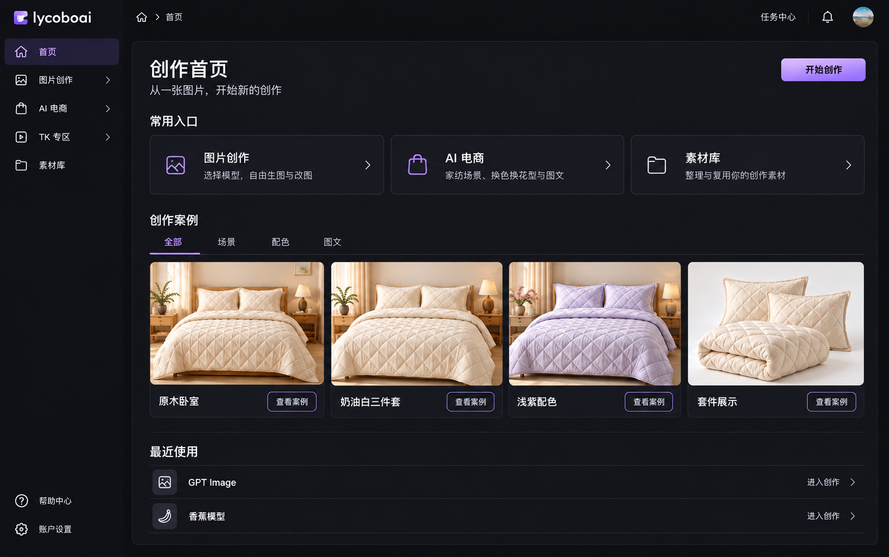
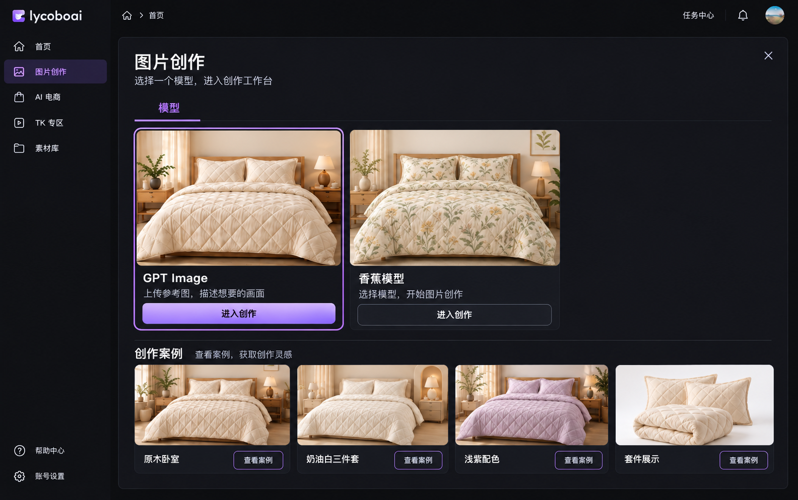
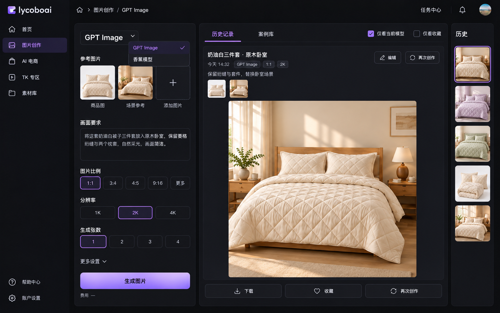

# 图片创作：三步连续 UI 设计

日期：2026-10-19。交付：三张独立桌面静态 UI 图。静态图为视觉目标；对应页面已实现，真实模型服务尚未接通，详见 [实现与验收](../image-studio-implementation.md)。

## 设计目标与依据

用户指定流程：后台整个页面 → 第一次点击图片创作 → 点击模型进入工作台。模型范围只保留 GPT Image、香蕉模型，不推定具体版本、供应商标识、性能、价格或 API 参数。香蕉模型保持用户提供的名称，尚未替换成未经确认的服务端型号。

视觉以 [DESIGN.md](../../DESIGN.md) 为准：深色中性表面、紫色渐变、HeroUI、紧凑导航。交互以用户提供的艺栢截图、已存研究及上一轮选择层定位纠正为依据。Refero 图库此前因订阅不可用，未声称本轮完成图库研究。使用内置 ImageGen，输入参考为 ai-commerce-selector-v3.png；完整提示词见 image-creation-flow-prompts.json。

| 决策 | 依据 | 本轮采用 |
| --- | --- | --- |
| 三张连续页面 | 用户本轮要求 | 完整首页、模型选择层、工作台 |
| 只有两个模型 | 用户本轮范围 | GPT Image、香蕉模型 |
| 一致的应用壳 | 用户要求、DESIGN.md | 同一 logo、导航顺序、顶部任务入口和配色 |
| 左边缘紧跟内容 padding | 用户上轮纠正 | 选择层不居中偏右，外围不透图片 |
| 左输入、中结果、右历史 | 用户参考与艺栢研究 | 单张大图结果、历史索引、参数区 |
| 家纺业务工具归 AI 电商 | 已确认 PRD | 本轮图片创作不加入家纺分类 Tab |

## 1. 后台完整首页

左侧首页选中，显示图片创作、AI 电商、TK 专区、素材库。首页包含常用入口、创作案例与最近使用。开始创作及图片创作入口均应打开下一张的模型选择层，不默认提交任务。最近使用中的模型可作为快捷入口；实际使用记录为空时不能伪造此区数据。

图中的案例、使用记录和商品图片是界面样例，不代表真实用户数据。案例仅用于浏览和选择参考，不能将家纺业务专用工具改归图片创作。

## 2. 第一次点击图片创作

图片创作选中，打开与主内容 padding 对齐的选择层。只显示 GPT Image、香蕉模型两张模型卡片，下面是独立的创作案例。只保留当前的模型分类，不为数量不足添加未接入模型或虚构工具。

选择层左边缘与页面内容起点对齐，剩余区域为不透明近黑背景；不透出首页的商品照片。顶部面包屑仍是底层首页，表示此时尚未进入模型工作台。关闭后返回首页状态。

点击模型卡片／进入创作后关闭选择层，进入对应模型工作台，不自动生成。案例查看与模型进入不是同一动作。

## 3. 再点击 GPT Image：三栏工作台

面包屑为图片创作 / GPT Image，侧栏图片创作保持选中。左侧表单包括模型切换、参考图、画面要求、比例、分辨率、张数和生成动作；中间保留历史任务上下文与单张大图；右侧为历史缩略图索引。

本图有意展开模型选择菜单，显示 GPT Image 与香蕉模型两个选项，用于评审切换入口；常规进入时菜单应默认收起。切换模型不能自动丢弃草稿；不支持的参数须说明并要求确认调整，不能静默提交。

大图使用奶油白菱格绗缝三件套：一条被子和两个匹配枕套。它是通用图生图的示例素材，不改变工具导航归属。历史点击仅定位，编辑才回填。生成按钮不显示虚构费用，未接入报价为 —。

## 4. 视觉检查与边界

已目视检查：三张图导航顺序、logo、深色紫色方向一致；模型层只有两个模型且外围无底层图；工作台提供左中右布局、可见生成动作、两模型切换和全局任务入口。不存在运行功能验收。

位图由模型生成，细字、图标、精确色值、表单与历史列宽、圆角及 padding 仍需在正式实现时按 DESIGN.md 校准，不能从图中反推 API 能力。图中的 1K／2K／4K、参考图数量和生成张数属于待核实的控件示意，真实支持项由最终选定模型与后端契约决定。

图像生成阶段仅检查图像、提示词与引用；后续代码实现、运行页面 E2E 与当前限制见实现与验收文档。真实生成服务仍未接通。
