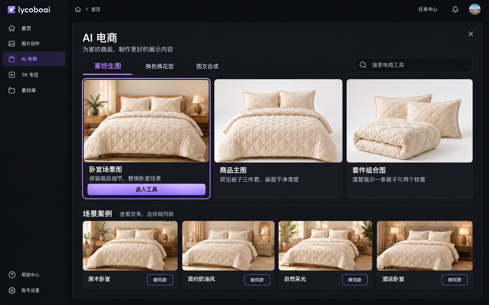
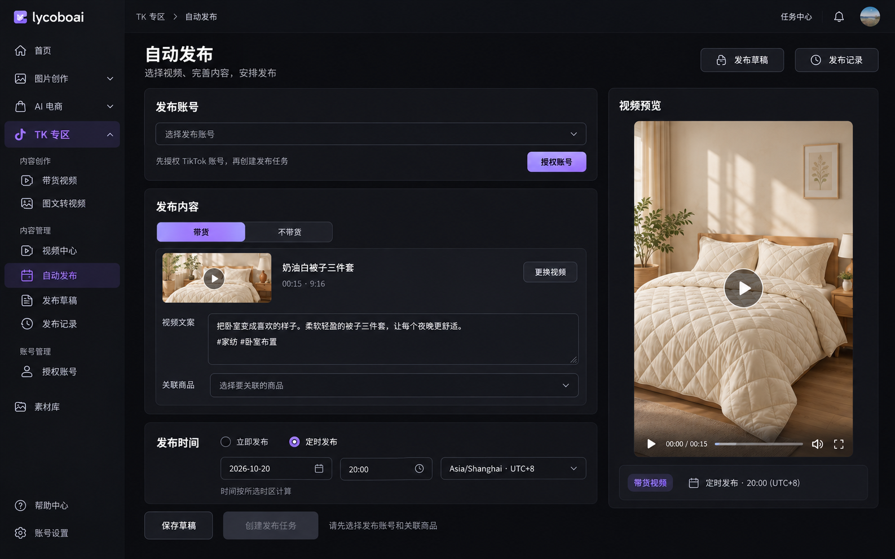

# 左侧导航、AI 电商与 TK 专区 UI 设计

日期：2026-10-19。文档状态：已确认的信息架构；图像状态：首轮静态 UI 设计，待用户评审。

## 依据与职责

产品信息架构以 [PRD.md](../../PRD.md) 为准，视觉以 [DESIGN.md](../../DESIGN.md) 为准。用户提供的艺栢截图用于工具分类展开，内容管理截图用于 TK 分组导航。Refero 订阅不可用，未声称查看其图库。图像使用内置 ImageGen 制作，不作为运行页面或平台接入证据。

| 决策 | 来源 | 用途 |
| --- | --- | --- |
| 首页、图片创作、AI 电商、TK 专区、素材库 | 用户本轮确认的信息架构 | 固定一级导航 |
| 家纺生图、换色换花型、图文合成归 AI 电商 | 用户对首轮图的纠正 | 更正工具层级 |
| 分类 Tab、效果卡片、再进入功能 | 用户截图与艺栢研究 | AI 电商选择层 |
| TK 分组展开，含自动发布与草稿／记录 | 用户截图与沟通 | TK 运营页导航 |
| 紫色渐变、近黑表面、紧凑组件 | DESIGN.md | 全部图的视觉约束 |

## 1. AI 电商工具选择层

左侧选中 AI 电商，选择层有家纺生图、换色换花型、图文合成三个 Tab。本图选中家纺生图，只显示卧室场景图、商品主图、套件组合图三个工具；下方场景案例与工具卡片分开。进入工具用于导航，做同款用于回填，均不自动生成。

本轮更正取代首轮图中将全部家纺工具归在图片创作下的分法。当前选择层进一步采用主内容 padding 锚定：左边缘与底层内容起点对齐，取消居中限宽；周围只露纯近黑背景，不透底层商品图。通用图片创作工作区与家纺功能可以复用布局，但功能标题、表单语义、导航归属需匹配对应工具。

## 2. TK 专区自动发布页

展示内容创作／内容管理／账号管理三组子菜单，自动发布选中。左侧配置发布账号、视频、文案、带货商品及时间，右侧预览被子三件套视频。设计为账号和商品尚未选择的未提交状态，不展示伪造账号、已发布结果或成功记录。授权账号提供下一步，发布动作在必要信息缺失时不可用。

定时配置显示日期、时间和明确时区；此配置仅用于设计目标，不证明 TikTok 接口或后台定时发布已实现。

## 3. 图像与提示词

案例为奶油白菱格绗缝被子三件套，场景使用原木卧室。被子、枕套、视频封面均是合成的设计素材，不是实际商品或用户成果。

完整提示词存于 navigation-and-tk-prompts.json。输入参考图为首轮 purple-tool-selector.png，用于保持紫色深色视觉；本轮明确改正其信息架构，不能反向沿用旧归属。

## 4. 验收范围

静态图检查导航归属、分组、弹层留白、主次操作、商品图片与时间信息。生成稿中的细字、图标、色值与尺寸以正式实现时的 CSS、HeroUI 和文案为准，不从位图反推 API 或设计 token。

本轮已目视检查两个结果：一级导航顺序一致，AI 电商选择层只有本分类的三个工具且案例另列，TK 分组与自动发布选中状态明确，日期／时间／时区可读，缺少账号和商品时主提交不可用。位图中的导航展开箭头、控件高度、精确圆角和非主操作的选中底色仍需按规范校准；例如带货分段选中使用轻紫底，正式实现不沿用位图中的主按钮渐变处理。视频封面是静态插图，不是可播放文件。

没有修改应用页面、接入发布或调用真实账号服务；未执行运行页面的 E2E。PRD、DESIGN 与本轮索引需保持同一套信息架构。

## 5. 选择层定位修订

用户指出 V2 偏右，侧栏和面板之间露出底层商品图片。V3 只修正定位与背景，保留分类、工具卡片、场景案例和紫色主题。当前图片以 V3 为准。

- 左边缘：侧栏右边缘 + 主内容 padding；桌面 24px，窄屏 16px。
- 上边缘：顶栏下边缘 + 主内容 padding。
- 右／下边缘：同一档主内容 padding；可用空间内布局，不使用居中限宽。
- 外围可见区域：不透明 #0F0F12，仅显示 padding 背景，不显示底层图片、文字或卡片。
- 对话框的焦点和关闭由 HeroUI 官方交互管理；视觉锚定不能改成手写焦点陷阱。

修订提示词见 tool-panel-alignment-prompt.json。静态生成图用来确认位置关系，实际实现应共享内容 padding 变量，以保证像素一致。
