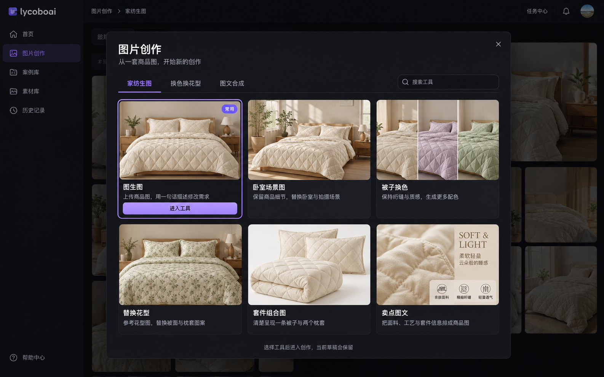
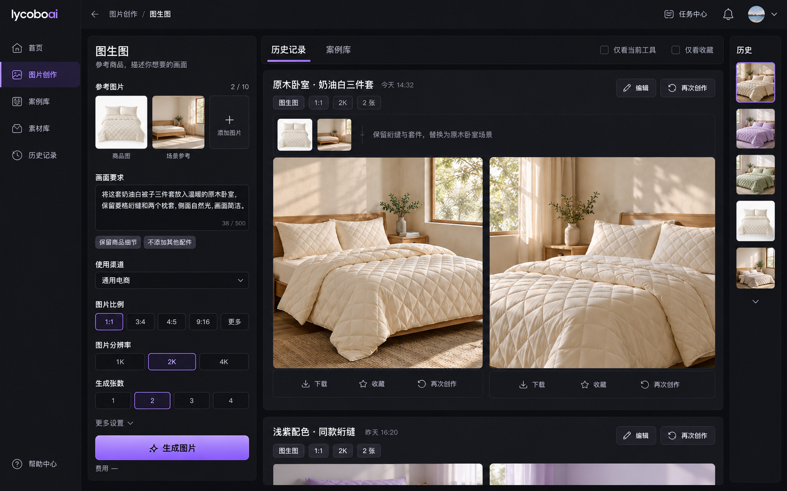

# 紫色 HeroUI 工作台 UI 图

日期：2026-10-19。状态：首轮静态设计稿，供评审，不代表可运行页面或真实生成服务。

本轮之后已确认家纺生图、换色换花型和图文合成归 AI 电商。本文件中的旧分类、侧栏和面包屑仅为首轮探索，不可直接作为实现目标；当前导航见 [新版 UI 设计](navigation-and-tk.md) 和 [PRD.md](../../PRD.md)。三栏布局仍可作为结构参考。

## 设计依据

- 视觉唯一标准：[DESIGN.md](../../DESIGN.md)，HeroUI v3、深色中性表面、紫色渐变主操作。
- 交互依据：用户提供的艺栢截图与[页面逻辑研究](yibai-page-logic.md)。
- Refero 当前返回 NO_SUBSCRIPTION，未使用其未能访问的图库作为已研究来源。
- 使用内置 ImageGen 生成 UI 图；生成稿不保证像素级色值、字体或组件 API 精确，后续实现以 DESIGN.md 和官方组件为准。

## 两个画面

1. 工具选择弹层：全局导航保留，遮罩上显示有四周留白的工具选择层；家纺效果卡片分为图生图、卧室场景、换色、换花型、套件组合及卖点图文。选择能力与案例做同款分别处理。
2. 图生图工作区：全局侧栏之外，左侧上传与参数，中间任务上下文及两张结果，右侧缩略图历史索引。编辑回填，历史定位不覆盖草稿；底部保留主要生成动作。

## 案例与视觉锁定

同一套奶油白菱格绗缝被子三件套：一条被子、两个匹配枕套；场景使用原木卧室和自然光。换色和花型卡片展示同类商品的浅紫、鼠尾草绿及小碎花变体。所有商品照片和结果均为设计示例。

| 决策 | 来源 | 采用范围 |
| --- | --- | --- |
| 紫色渐变、深色表面与紧凑圆角 | 用户确认、DESIGN.md | 主操作与界面层次 |
| 分类 → 效果卡片 → 功能页 | 用户截图、艺栢交互研究 | 工具入口 |
| 左表单、中结果、右历史 | 用户请求、艺栢交互研究 | 桌面图生图工作区 |
| 家纺业务名称优先 | 用户定位 | 卡片与参数文案 |
| 图片主导，界面克制 | DESIGN.md | 不增加装饰横幅、光晕或复杂背景 |

不在图中编造余额、通知数量、生产用户、费用或进度。生成服务未接入，图中的任务和图片仅说明目标交互，不作为实现证据。

完整生成提示词见同目录的 purple-studio-prompts.json。

## 首轮检查与实现注意

已检查两张生成图的整体布局、留白、品牌强调、商品图片占比及主要操作可见性。工具选择层为三列两行；工作区包含参考图、文字要求、输出设置、两张结果及独立历史索引。未修改应用页面或业务代码，未执行运行页面的浏览器验收。

生成图不作为产品像素级和文案级验收：细小图片内文字、字符计数、两张图之间的侧栏宽度／logo，以及结果图中的枕套轮廓一致性均需在后续实现与素材制作时校准。三件套必须明确为一条被子与两个枕套，不得由生成素材推断实际 SKU 配件。

源参考：DESIGN.md、用户提供截图、艺栢交互研究。目标状态：桌面、深色、弹层打开／已有两张结果。结论：可用于首轮方向评审，尚未批准为最终实现截图。
