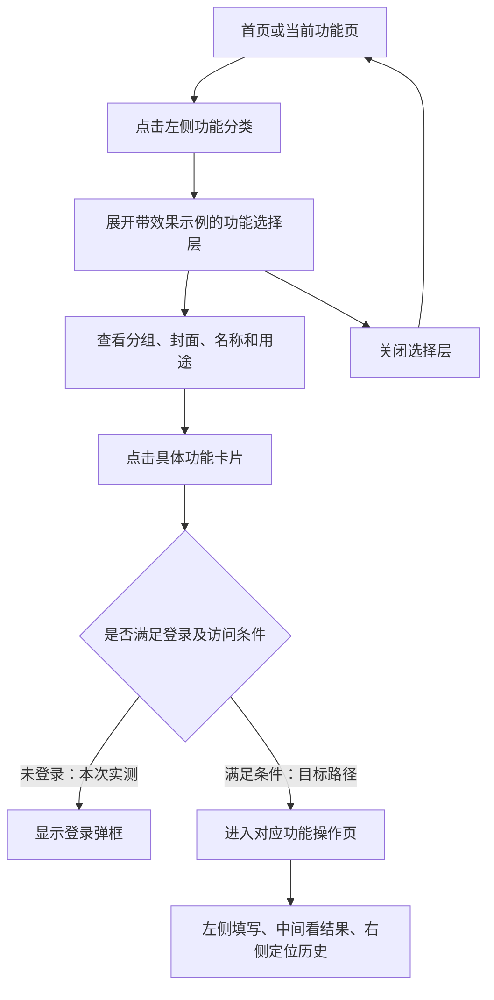

# 艺栢页面与操作逻辑研究

研究日期：2026-10-19。状态：交互研究，供后续 PRD、DESIGN 和 UI 设计借鉴。

本报告记录第三方页面行为和已发布前端代码中的逻辑，不代表 lycoboai 已实现这些能力，不替代现有产品规格。后续设计应结合家纺行业、真实服务能力和用户确认的范围选择采用。

## 1. 研究对象与证据范围

- [首页与功能入口](https://yibaiaigc.com/dashboard)。
- [普通画图操作页](https://yibaiaigc.com/chatdraw)。
- 用户提供的登录态截图：功能选择层、左中右创作区、家纺结果及历史记录。
- REA 控制浏览器实测：临时未登录会话、1600 × 1000 视口、中文语言环境。
- REA 静态分析：页面公开加载的 JavaScript；另读取公开 CSS 中的布局声明。取得的是发布产物，不是原始工程或服务端代码。

| 标记 | 含义 |
| --- | --- |
| 实测 | REA 实际执行页面操作，并记录操作前后 DOM、可访问性树和 URL |
| 代码 | 已发布前端 JavaScript 或 CSS 中存在，未必执行过该路径 |
| 截图 | 用户截图中可见，不额外推断点击后的行为 |
| 建议 | 为 lycoboai 提出的设计选择，尚未实施 |
| 未验证 | 没有足够证据，不当作已确认能力 |

本次没有登录、上传文件、提交生成、消耗积分或删除记录。功能卡片点击存在登录门槛；直达公开画图页可以查看和填写表单。后端队列、真实模型、计费和持久化不在验证范围。

## 2. 一级分类 → 功能选择层 → 功能操作页



满足条件后进入操作页，是结合页面配置、公开功能页和用户截图得到的目标路径；本次卡片点击只实测到了登录分支，不写成完整通过登录态验证。

### 2.1 点击一级分类不会立即跳转

实测路径：在 `/chatdraw` 填写草稿 → 点击左侧“图片创作” → 显示功能选择层。

- URL 保持 `/chatdraw`，原表单仍在下层，输入的草稿保留。
- 选择层包含标题、关闭按钮、分组导航、功能卡片和内部滚动区。
- 左侧一级分类可见；选择层有自己的边界和外边距。
- 关闭后回到原页面，URL 不变，草稿保留。
- 本次视口中，DOM 内联样式为 left 220px、top 98px、width calc(100vw - 400px)、height 882px。这是该次观察值，不是所有分辨率的固定规格。

侧栏点击先进入“挑选功能”的状态；具体能力由下一次卡片点击决定。

### 2.2 同一层内有分组导航

“图片创作”选择层显示“模型”和“创作”分组，内部包含相应标题和卡片。

实测点击“创作”分组按钮后，URL 不变、选择层仍打开、下层草稿保留。DOM 使用 `SecondMenuPanel-anchor` 分组入口，同一层内保留分组内容；不应将其记成两个独立路由页面。平滑滚动的精确位置、所有分类切换和键盘行为未逐项验证。

### 2.3 功能卡片用效果帮助选择

卡片结构来自 DOM 与截图：主要面积展示图片或循环视频，下方是名称和简短用途，可附带会员、新功能和选中状态标记。

这里的效果封面展示“功能能做什么”，与创作页中可回填的具体案例有区别。

| 入口 | 用途 | 是否直接生成 |
| --- | --- | --- |
| 功能选择层的卡片 | 选择能力、进入相应操作页 | 否 |
| 操作页的案例卡片 | 查看具体结果及资料，再用“做同款”复用 | 否，先回填表单 |
| 表单生成按钮 | 提交当前参考图、提示词和参数 | 是，须通过访问及计费校验 |

实测从首页展开图片创作，点击 `image-2` 卡片后显示登录框。本次未绕过登录，不能假定所有卡片均可匿名进入。

## 3. 操作页布局：全局导航与业务三栏

```text
顶部：教程、公告、积分与账户
─────────────────────────────────────────────────────
全局导航 │ 左：当前表单       │ 中：任务流／案例    │ 右：历史索引
         │ 参考图、提示词    │ 历史参数与参考图   │ 缩略图
         │ 比例、分辨率、质量 │ 图片与结果操作     │ 当前项高亮
         │ 固定生成按钮      │ 大图查看入口       │ 失败项与定位
```

已发布桌面 CSS 声明：全局导航 200px、工具区 378px、右侧历史区 108px，中间分配剩余空间。这些是来源值，后续不直接照搬到所有屏幕。

左侧参数区独立滚动，底部生成区固定；中间浏览任务或案例；右侧历史区独立滚动。提示词、参考图、参数和输出共同构成一次操作的上下文。

## 4. 左侧表单与输入逻辑

### 4.1 文生图和图生图统一输入

| 项目 | 当前观察 | 证据 |
| --- | --- | --- |
| 功能标识 | image-2 | 实测 |
| 参考图 | 可选，最多 10 张 | 实测、代码 |
| 提示词 | 必填，maxlength 9000，有计数 | 实测、代码 |
| 常用比例 | 1:1、2:3、3:4、4:5、9:16 | 实测 |
| 更多比例 | 3:2、4:3、5:4、16:9、21:9，菜单展开 | 实测 |
| 分辨率 | 1k、2k、4k；默认 2k | 实测、代码 |
| 质量 | 低、中、高；默认中 | 实测、代码 |
| 默认比例 | 1:1 | 实测、代码 |

空提示词时按钮禁用；只输入提示词、不添加参考图，按钮会启用。前端依据参考图组装请求并计算报价，无须先选择文生图／图生图模式。

当前输入与中间正在查看的记录分别管理。已实测切换历史／案例面板后保留提示词和质量选择；跨功能导航、刷新或关闭浏览器后的草稿恢复未验证。

### 4.2 上传处理

发布的上传组件代码包含文件选择、拖放、粘贴、多图排序、图片编号、移除、清空、本地预览、上传中、失败反馈、图片预处理和编辑入口。

顺序可概括为：选择文件 → 客户端检查／预处理 → 本地预览 → 上传取得 URL → 将成功取得 URL 的图片纳入生成参数。

这些路径未实传验证。客户端格式、大小和预处理尺寸不等同于服务端已验证的限制，也不直接成为我们的产品承诺。预处理可能影响细花型、绗缝和面料纹理，需要结合实际提供商测试家纺素材。

### 4.3 参数和积分报价联动

| 实测条件 | 按钮显示积分 |
| --- | --- |
| 无参考图、1:1、2k、中质量 | 20 |
| 默认条件只改为 4k | 25 |
| 默认条件只改为高质量 | 50 |

这是研究时的展示样本，没有实际扣费，不是固定价格表，不说明账号折扣、其他模型或实际计费结果。

代码的报价模式结合是否有参考图、分辨率、质量和规则计算；公共按钮组件还有折扣展示逻辑。可借鉴的是参数变化后在提交按钮旁更新报价。

## 5. 中间任务流、案例与详情

### 5.1 一次提交对应一条任务

页面组装参考文件 URL／宽高／类型、`prompt`、`aspectRatio`、`resolution` 和 `quality`。提交路径包含提交中保护、表单校验、错误提示和成功后取得任务 ID。

生成接口没有调用，不能据此保证服务端幂等性、计费正确或排队可靠。

截图与代码共同表明，任务记录关联当时的提示词、参考图、参数和结果。用户可以核对“用了哪张图、改了哪里、得到了什么”；输入缩略图与输出必须区分。

### 5.2 历史与案例共用中间区域

- 页面提供历史记录、案例库、仅看当前功能、仅看收藏。
- 未登录临时会话默认展示案例，切历史显示空记录。
- 代码按用户保存当前面板和筛选偏好；不等于服务器持久化草稿或任务。
- 历史查询按功能、收藏条件分批加载；不能从空历史推断登录态记录完整性。

### 5.3 详情与“做同款”

实测：点击案例图片 → 打开详情弹框 → 查看大图、尺寸、缩放、参考图和缩略图索引 → 点击做同款。

结果：详情层关闭，参考图和提示词进入左侧；代码还恢复比例、分辨率和质量。之前填写的临时草稿被替换，页面停在待提交状态，没有自动生成。

可改进点：保留快速复用，增加撤销替换或草稿恢复。

详情实际提示使用效果缩略图展示，下载可查看原图。下载成功、原始质量和权限未实测；可借鉴轻量浏览、大图按需获取的资源策略。

## 6. 定位、编辑、再次生成的区别

| 动作 | 逻辑 | 证据 |
| --- | --- | --- |
| 右侧历史定位 | 定位中间记录，更新高亮，不走编辑回填 | 代码、截图 |
| 编辑旧任务 | 验证编辑权限后，恢复参考图、提示词、比例、分辨率和质量 | 代码；未在登录态执行 |
| 再次生成／重绘 | 获取旧任务重绘权限和报价；有费用时确认，再提交取得新任务 ID | 代码；未执行付费行为 |
| 案例做同款 | 用案例资料回填，用户再确认生成 | 实测、代码 |

编辑不直接等于付费生成；再次生成不应隐式使用当前左侧草稿。循环箭头结合代码应解释为重绘，不直接标注成免费失败重试。

## 7. 右侧历史与连续工作

### 7.1 中间与右侧双向定位

代码中，点击右侧项会定位中间索引、更新当前任务；中间记录滚动到定位范围时会更新右侧选中项。

截图显示失败项保留在历史索引中。删除入口存在，代码有请求成功后移除记录的处理；确认、软删除、撤销，以及是否取消运行中任务均未验证。

### 7.2 新任务展示与状态更新

以下来自发布前端代码，未实际提交生成验证全程：

- 在任务流顶部时，新任务直接加入顶部。
- 浏览旧记录时先进入待展示列表，回到顶部附近再并入，减少阅读位置变化。
- 在案例面板提交成功后，切换历史面板展示任务。
- 未完成任务参与状态查询，约 1500ms 的定时调度继续检查并更新变化及完成项。
- 无未完成任务时停止查询；页面退出有停止逻辑。

不能据此断言后端使用某种队列、服务推送或精确进度算法。值得借鉴的是新结果有稳定入口，同时保护阅读位置和当前输入。

## 8. 给 lycoboai 的采用建议

以下是待后续 PRD／设计确认的建议，不表示已实现。

| 来源模式 | 采用建议 | 注意点 |
| --- | --- | --- |
| 分类展开选择层 | 用少量大类组织工具，内部显示效果和用途 | 不让几十个细入口占满侧栏 |
| 封面帮助选择功能 | 使用三件套换场景、换色换花型、套装排版示例 | 功能封面与可回填案例区分 |
| 进入独立操作区 | 保留左侧表单、中间任务、右侧索引 | 切换功能有可恢复草稿 |
| 统一普通生图表单 | 首版图生图为主要方式，保留文字创作 | 不强迫先理解技术模式 |
| 常用参数直接可见 | 按使用频率安排，支持渠道预设 | 不预设全部参数都需隐藏；禁用不支持组合 |
| 历史保留制作条件 | 参考图、要求、结果和参数摘要一起看 | 花型、套装构成、材质尺寸以用户资料为准 |
| 定位与编辑分开 | 浏览不覆盖输入，编辑／再次生成／作为参考独立 | 报价重绘与失败重试分别定义 |
| 案例回填 | 家纺案例带入可编辑要求，有草稿恢复 | 不自动提交 |
| 持续异步工作 | 提交后继续创作，全局任务中心持续可访问 | 依赖真实鉴权、持久任务、存储和计费 |
| 轻量预览与按需大图 | 网格和历史用缩略图，检查细节再取大图 | 保证花型和纹理可检查 |

已沟通方向：面向中文操作的中国家纺跨境卖家／工厂运营，被子三件套先行；首版普通生图与图生图，换场景、换色换花型、套装图、卖点图均为常用需求；选渠道后带入输出规格。带货视频和自动发布后续再做。平台规格与提供商兼容范围仍须正式核对，不能从参考站比例按钮直接推导。

视觉继续采用项目近黑表面、薄中性边框、紧凑导航、克制汽水绿。本报告不要求复制艺栢标识、会员标签、数量、固定列宽和模型组织方式。

## 9. 后续设计验证清单

- 分类展开后，当前分类、关闭和返回方式明确。
- 关闭选择层后，原页面、草稿和阅读位置可用。
- 功能卡片解释用途，区分进入工具和使用案例。
- 切换新功能时有草稿恢复策略；不声称参考站已验证跨功能恢复。
- 当前输入与所查看记录分别管理。
- 点历史缩略图只定位；编辑和再次生成动作明确。
- 参数只展示实际支持组合，报价真实，提交前校验。
- 上传中、失败或参考图不完整不会被静默当作成功输入。
- 多次提交分别保存参考图和参数，旧任务不随当前选择变化。
- 新结果可找到，不强制跳离当前页面或打断阅读。
- 触屏、键盘、焦点恢复、减少动态效果和窄屏布局另行验收。

## 10. REA 证据索引

ID 可在本次研究会话中追溯，不是在线公开报告链接。临时浏览器会话、原始 DOM 和分析包未纳入仓库；另一台电脑可按上述步骤重查公开页面。第三方站点会变化，不能保证长期得到相同结果。

| 编号 | 场景 | 证据 ID |
| --- | --- | --- |
| E01 | 直达画图页与默认表单 | `ev_8932ca977330dde630e75c7802ea47ad517c00c17eccc6f9d1978dfb6e0c3a40` |
| E02 | 提示词、分辨率报价和更多比例 | `ev_2b333972e76abf6e69e38e1a69d8a5fbee4f1d99db4f93e4d067f562edd7c1b0` |
| E03 | 质量报价与历史切换保留输入 | `ev_59d702a1f4c6b53f2775859bf6615fb5f2335e5dda703448f13490b4e967618d` |
| E04 | 案例详情 | `ev_b241226ac5de579dbe6b9859a70a3a04ccf385ff047557d98023f43f085e1d15` |
| E05 | 做同款回填、替换草稿 | `ev_b4ec973e442834646a96d081313bef60d442db8f55692ed3509b1bdb68e65207` |
| E06 | 功能页展开选择层 | `ev_235ddbd4faab5cd2de551a189ef898e227aacf940fea84b6f3723e2f5d4cf32f` |
| E07 | 首页卡片点击后的登录门槛 | `ev_64a2eca257015d8ac99cc3e6e196c45dd8619130c58eabce24bf2e915a8b1389` |
| E08 | 分组操作及关闭后保留草稿 | `ev_a416345f6586b2f08c10a17a04fdfa6a4585dc80fbe32ffcff4a1be3d307492c` |
| E09 | 6 个发布 JS 的静态分析父记录 | `ev_ab4bcbd1a2e653720bf52bad14f80466bdafa54ea01b0188c0847efb6e7ab4bb` |

E09 来源：`IndexPage-Bovsl_Wz.js`、`useMainContent-gkTIBdkY.js`、`MainLayout-9szlyfG0.js`、`DemoPage-r33IA25t.js`、`CommonUploader-BiMIYUdd.js`、`promt-EfH76jiM.js`。布局另参考 `MainLayout-BEkcQ81W.css` 和 `ToolLayout-CVnEuUWN.css`。文件名含构建标识，站点更新后可能变化。REA 静态关系覆盖不完整，未分析依赖和服务端保持未知。

未验证：登录后的完整卡片跳转、跨功能草稿恢复、真实上传、服务端校验、真实生成及失败、扣费退款、删除恢复、服务端持久化、提供商身份、平台规范、移动端布局，以及选择层全部退出和键盘行为。
